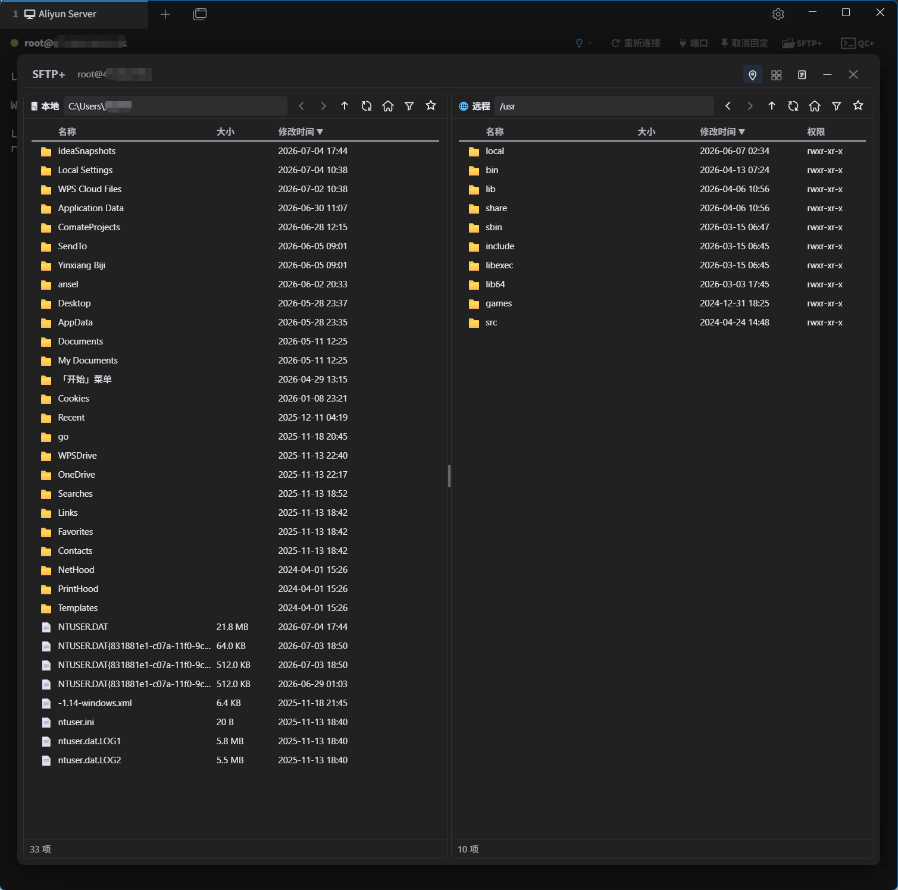
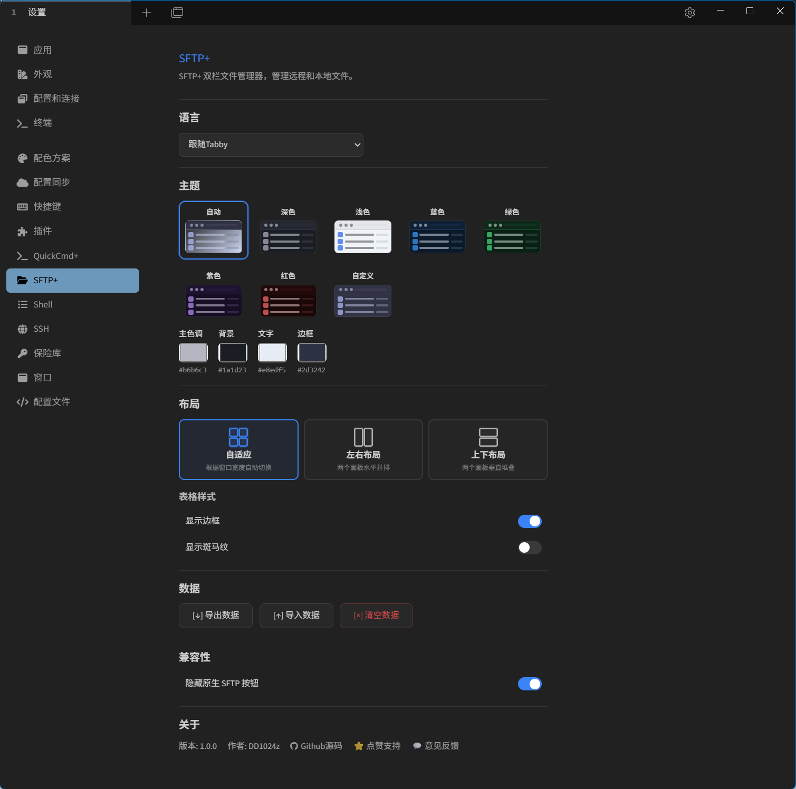

# SFTP+ — Dual-Pane SFTP File Manager for Tabby

**[中文](https://github.com/10D24D/Tabby-SFTP-Plus/blob/main/README.md) | English**

[](https://github.com/10D24D/Tabby-SFTP-Plus)
[](https://github.com/10D24D/Tabby-SFTP-Plus/stargazers)
[](https://github.com/10D24D/Tabby-SFTP-Plus)

SFTP+ is a plugin for [Tabby Terminal](https://tabby.sh/) that adds a **dual-pane SFTP file manager** right inside your SSH terminal tabs. Each pane can host the **local disk** or **any remote connection**, giving local↔remote, local↔local, remote↔remote and remote↔local setups. Features include **drag-and-drop transfers**, **bookmark system**, **path memory**, transfer logs, file conflict handling, permission editing, and more — all without leaving the terminal.

---

## 📋 Features at a Glance

| Category | Description |
|----------|-------------|
| **📂 Dual-Pane Manager** | Each pane can host the **local disk** or **any remote connection** (local↔remote / local↔local / remote↔remote / remote↔local); horizontal / vertical / adaptive / single-pane layouts; draggable splitter, double-click to reset |
| **🔗 Connection Management** | The **connection picker** in the title bar switches either pane's endpoint in place: it lists open SSH tabs and unopened configured connections, each with a disconnect action (without affecting the panel's own tab) and a "current / other pane / not opened" marker; open it from the connection title or the pane's endpoint badge; the title-bar connection name toggles between "user@host" and the **alias** (falls back to user@host when no alias); reconnect happens in-place and in the background within the existing tab — no focus steal, the list shows "Waiting for <connection>" while disconnected, and returns to the last directory on recovery |
| **👁️ View / Edit** | Built-in text/image viewer and text editor (local + remote); extra editable extensions or allow-all-types (binaries still protected); image navigation (prev/next in same directory); copy / copy selection; text context menus for copy, cut, paste, and select-all; view-as-text; open or edit in the system default app; **virtualized line rendering** for large text (big logs scroll smoothly), **toggleable line numbers**, three viewer caret shapes (block / beam / underline, matching Tabby's terminal values); saving over a remote file changed by another program asks for confirmation first |
| **🎨 File Icons** | Built-in colored SVG file/folder icons; overlay badge for symlinks / shortcuts; customize extension mappings, icon directory, disabled built-in icons, and folder icon |
| **🔄 Drag & Drop** | Drag across panes to upload/download; recursive folder transfer; drag from OS Explorer/Desktop into either pane |
| **⬆️ Context Transfer** | Upload or download decided by the actual endpoints; a direct "transfer" when both panes are the same kind (multi-select batch) |
| **⚡ High-Speed Transfer** | Intra-directory file-level parallelism (1-10 concurrent, adjustable); tar channel for massive small-file directories (pack → single-file transfer → unpack), greatly reducing round trips; **five selectable channel modes** (Smart / SFTP only / TAR only / Prefer SFTP / Prefer TAR); **multi-selecting entries under one parent directory can pack them into a single archive**; batch delete via SSH `rm -rf` / `fs.rm(recursive)` |
| **🔖 Bookmark System** | **Global** bookmarks (visible in any tab) + **scoped** bookmarks (visible only in tabs of the same connection — local tabs included); group by scope or flatten and mix, with draggable group order; sort by **drag order / usage / name**; one click to **locate the bookmark for the current path**; the popup is resizable (double-click a handle to reset) and can be **pinned open** (stays put — clicks elsewhere won't close it / close on select, both panes can keep their popup open at once, and it re-anchors to its own pane on resize at the size you dragged), and a bookmark can carry a **linked path** that moves the other pane along |
| **📋 Transfer Log** | Full operation history including **Edit Load** / **Edit Save** types; filtering, stats, JSON export |
| **⚡ Transfer Control** | Progress bars (with percentage), pause/resume/cancel, resume support, real-time speed, **estimated time remaining**; outside TAR-only mode the tar channel falls back to the regular file-by-file transfer on failure; the transfer log tags transfers (⇄ SFTP / 📦 tar packing / file count); **a missing target directory is pre-flighted** (create / use current directory / cancel); submitting the same transfer twice is intercepted with a notice |
| **⚠️ File Conflict** | Visual diff on conflict (shows upload⬆/download⬇ direction), with overwrite/skip/rename options (**rename numbers duplicates by default**, or use timestamps / random suffixes) and batch processing; merge-overwrite has its own progress panel; content digests can be shown in the dialog, identical files can auto-skip, and differing digests are marked ≠ |
| **🔐 Permission Editor** | Remote chmod via 3×3 checkbox matrix with octal preview; unreadable permissions and failed changes are now reported instead of failing silently |
| **📌 Context Menus** | Upload/download, view/edit, new/rename/delete, copy/cut/paste, refresh, select all/invert; text viewer/editor context menus; <br />Header: column visibility, fit widths, borders & zebra stripes; menu items can also be disabled, not just reordered |
| **🔍 Filter & Sort** | Keyword filter, multi-column sorting (click headers), configurable visible columns; **Group** (None / Name / Date modified / Type / Size) splits the list into collapsible groups with expand-all / collapse-all, ↑/↓ stops on group headers and clicking a header selects the whole group; with focus on a file list, type a name prefix to jump to the match (Explorer-style; IME such as Chinese is supported); an absolute path typed into the address bar navigates there and highlights a trailing file |
| **🧭 Path Mode** | Four modes: `off` / `remember` / `sync` (sync with terminal) / `mirror` (both panes locked to one directory, available when both are local or both remote); configurable default |
| **🎨 Theme System** | 7 presets + custom colors, supports following the Tabby system theme |
| **⌨️ Panel Hotkey** | Customizable panel toggle hotkey with record/clear/conflict detection; panel actions (delete/rename/refresh/go up/back/forward), open/view/edit and common context-menu actions support **multiple key bindings**, and can be bound to mouse side buttons (Mouse3/Mouse4), the **mouse middle button and wheel up/down** (optionally with Ctrl/Alt/Shift/Win), plus an occupied-hotkey reference list |
| **🌐 Internationalization** | 24 locales (zh/en complete; other languages fall back to English for missing keys); auto-detects Tabby/browser language |
| **📦 Data Backup** | Export/import data (bookmarks, transfer logs, settings, path memory); **export is selectable per category** (Language / Theme / Layout / Object icons / Other / Transfer settings / Hotkeys / Bookmark data / Transfer logs) — unselected categories are not written, so importing such a file naturally leaves that data untouched |
| **🐞 Feedback** | Built-in "Report a Bug" / "Feature Request" in Settings, routed to the matching issue template for the UI language with the Tabby version, OS, frontend type and installed plugin list pre-filled |

---

## 🖥️ Interface Guide

|  |  |
| :------------------------------------------: | :---------------------------------------------: |

---

## 📥 Installation

1. Make sure [Tabby Terminal](https://tabby.sh/) is installed
2. Configure the plugin directory in Tabby settings
3. Place the built plugin (see "Development" section) into the plugin directory, then restart Tabby
4. Open any SSH terminal tab — the **SFTP+** button should appear in the toolbar

---

## 🚀 Quick Start

1. **Open** — Click the `SFTP+` button in the toolbar of an SSH terminal tab
2. **Browse** — Navigate local files on the left and remote SFTP directories on the right; double-click to enter a directory
3. **Transfer** — Drag across panes, or use right-click upload/download
4. **View/Edit** — Right-click text or image files to view in-app; edit text and save (remote files upload automatically)

---

## 📏 File Size Limits

| Operation | Limit |
|-----------|-------|
| Text view | 2 MB (virtualized line rendering in the built-in viewer) |
| Image view | 15 MB |
| Text edit | 5 MB |

Exceeding a limit shows a clear dialog and toast with the cap.

---

## ⚙️ Settings Panel

Navigate to Tabby Settings → "SFTP+" in the left sidebar:

| Setting | Description |
|---------|-------------|
| **Language** | Follow System / Chinese / English |
| **Theme** | Auto / Dark / Light / Blue / Green / Purple / Red / Custom |
| **Custom Colors** | Independently set primary, background, text, and border colors |
| **Layout** | Adaptive (auto-switches based on panel width) / Horizontal / Vertical |
| **Table Style** | Show borders, show zebra stripes |
| **Upload/Download Concurrency** | Intra-directory file-level concurrency (1-10), takes effect immediately |
| **Transfer Channel Mode** | How folder transfers pick a route — five options: **Smart** (route by file count and size, default) / **SFTP only** (always file by file, no packing probe) / **TAR only** (always pack; fails hard with a reason when unavailable) / **Prefer SFTP** / **Prefer TAR**. The old "Tar Packing Acceleration" and "Fast Mode" toggles migrate into this setting automatically |
| **Default Upload/Download Paths** | Configure separate upload and download target directories; empty values use the current pane directory |
| **Default Path Mode** | Path mode for new connections on first open (off / remember / sync / mirror) |
| **Default Show Hidden** | Whether to show hidden files on new connections |
| **Additional editable extensions** | Extra extensions the built-in editor may open besides the text whitelist (e.g. `service, tf, plist`); accepts `.conf` / `*.conf` / `conf` |
| **Allow editing all file types** | Ignore the extension whitelist (off by default); binary content is still blocked to avoid corrupting files in a text editor |
| **Viewer & Editor** | Line-number toggle (on by default); three viewer caret shapes (block / beam / underline, matching Tabby's terminal cursor) |
| **File Icons** | Choose an icon resource directory, configure extension mappings, disable built-in icons, and replace the folder icon |
| **Toolbar Customization** | Drag-to-reorder toolbar buttons, hide unused items; pin buttons so they never collapse, or enable the ⋯ overflow menu — that menu lists every button with a per-row pin to move it in or out; the close button can be hidden once a panel toggle hotkey is bound |
| **Panel Opacity** | Adjustable 0.5–1; overlays and dialogs follow the same opacity (minimum 50%) |
| **Apply Settings Instantly** | On by default; when off, changes take effect only after closing and reopening the SFTP+ panel — handy when changing many options at once |
| **Panel Hotkey** | Custom panel toggle hotkey; panel actions (delete/rename/refresh/go up/back/forward), open/view/edit and common context-menu actions can be bound to multiple keys, and also to mouse side buttons (Mouse3/Mouse4), the mouse middle button and wheel up/down, with an occupied-hotkey reference list |
| **Data Backup** | Export/import data (JSON), selectable per category on export; clear all data (requires typing `DELETE` to confirm) |
| **Feedback** | Report a bug / request a feature (Tabby version, OS, frontend type and installed plugins are pre-filled) |
| **Compatibility** | Hide the native Tabby SFTP button to avoid conflicts |

---

## 💾 Data Backup

All data (bookmarks, transfer logs, path memory, settings) can be exported to and imported from a JSON file. Export is **selectable per category** (Language, Theme, Layout, Object icons, Other, Transfer settings, Hotkeys, Bookmark data, Transfer logs); unselected categories are not written — the import side treats a missing field as "do not overwrite", so an appearance-only backup will not wipe bookmarks or transfer logs.

Path: Settings → Data Backup → Export / Import

---

## 📜 Changelog

Latest version: **v3.0.0** (2026-10-22) — [Full changelog](CHANGELOG.en.md)

---

## 🛠️ Development

### Tech Stack

| Category | Technology |
|----------|-----------|
| Framework | Angular 9 |
| Language | TypeScript 5.8 |
| Build | Webpack 5 |
| Styling | Inline styles (CSS variables for adaptive theming) |
| Dependencies | `tabby-core` / `tabby-settings` / `tabby-terminal` |
| Protocol | SFTP (reuses Tabby SSH Session) |

### Build

```bash
# Install dependencies
npm install

# Development mode (watch mode)
npm run watch

# Production build
npm run build
```

The built plugin bundle is in `dist/` (`index.js` + auto-generated `package.json`).

### Project Structure

```
tabby-FTPS+/
├── docs/
├── scripts/                       # Build helpers (copy-sftp-manifest generates dist/package.json)
├── src/
│   ├── index.ts
│   ├── tabby-shims.d.ts
│   ├── services/                  # sftp.service / bookmarks / i18n / transfer-log / config (Tabby convention)
│   ├── settings/                  # sftp-settings component (Tabby convention)
│   ├── tabby/                     # Terminal integration: config/hotkey providers, terminal-decorator
│   └── sftp/                      # SFTP feature module
│       ├── sftp-floating-panel.component.ts
│       ├── sftp-workspace-tab.component.ts
│       ├── components/            # View layer (V): file panes, dialogs, context menu, conflict, transfer queue…
│       ├── controllers/           # Controller layer (C): column / viewer / bookmark controllers
│       └── core/                  # Logic / utils / types: transfer, conflict, digest, drop, clipboard, path…
├── locale/                        # 24 GNU gettext .po locales
├── tabby-plugin-common/           # Shared utilities across plugins (theme / utils)
├── dist/                          # Build output (index.js + package.json, gitignored)
└── package.json
```

See [docs/DEVELOPMENT.md](docs/DEVELOPMENT.md) for the full tree.

---

## 🤝 How to Contribute

Contributions are always welcome! The plugin was conceived by the author (DD1024z), with the majority of implementation code generated using AI assistance.

- Report bugs or request features: [GitHub Issues](https://github.com/10D24D/Tabby-SFTP-Plus/issues) 📝
- Contribute code: Fork the project and submit a Pull Request 🚀
- Like SFTP+? Give it a [⭐ Star](https://github.com/10D24D/Tabby-SFTP-Plus) to show your support!
- Prefer something more direct? [☕ Treat me to a coffee](https://ko-fi.com/dd1024z) — every bit keeps it going.

Your stars and support are what keep me developing — thank you! ❤️

## 🙏 Special Thanks

SFTP+ would not have grown without the foundational projects and the community's support. Special thanks to:

- [Tabby](https://tabby.sh/) — the powerful cross-platform terminal that hosts this plugin
- [SFTP (SSH File Transfer Protocol)](https://en.wikipedia.org/wiki/SSH_File_Transfer_Protocol) — the underlying file transfer protocol this plugin's remote file management is built upon
- [Tabby SFTP-UI](https://github.com/growingupfirst/tabby-sftp-ui) — an early two-pane SFTP file manager whose interaction and implementation ideas served as an important reference; some of SFTP+'s feature designs were inspired by it
- [@fweiger](https://github.com/fweiger) — Issue #13: a detailed UX optimization report (click/double-click interaction, right-click menu ordering, hotkey focus, etc.); several points shipped in v2.0.2
- [@HarpyWar](https://github.com/HarpyWar) — Issue #3: reported a broken hotkey settings page; fixed
- [@xingkongxiademodeng](https://github.com/xingkongxiademodeng) — Issue #10: flagged the serial (non-concurrent) directory upload bottleneck, guiding the concurrency optimization
- [@Hanzo-Huang](https://github.com/Hanzo-Huang) — Issue #5: suggested "get current working directory" like native SFTP; implemented
- [@Purgepyro](https://github.com/Purgepyro) — PR #18: additional editable extensions, allow-edit-all-types, and a fix for blank built-in icons after a manual install
- [@waylandun](https://github.com/waylandun) — Issue #21: editor paste leaked into the SSH terminal; PR #22 isolates text-input keys at the panel root (verified on macOS)
- Thanks also to [@webbrain-one](https://github.com/webbrain-one) and [@JayceVane](https://github.com/JayceVane) for their Pull Request attempts

## 📝 License

SFTP+ is licensed under the [MIT](LICENSE) license. Feel free to use, modify, and share it — just comply with the terms.

## ⚠️ Disclaimer

SFTP+ is a free and open-source project, primarily built with AI-assisted generation, so bugs and defects are inevitable. The author cannot guarantee that all features and code have been thoroughly verified. By using this plugin, you agree to assume the associated risks. The developer shall not be held liable for any problems or losses arising from its use. Please use it at your own discretion.
